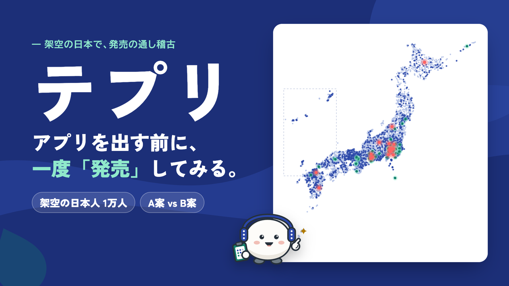
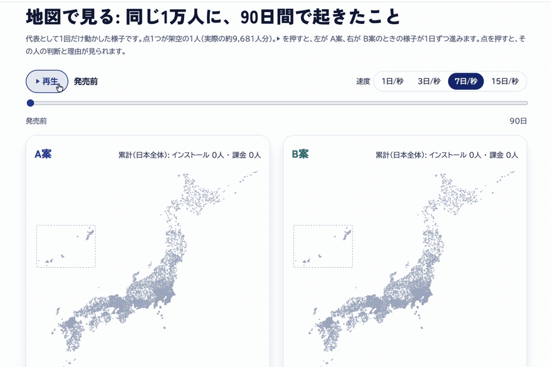
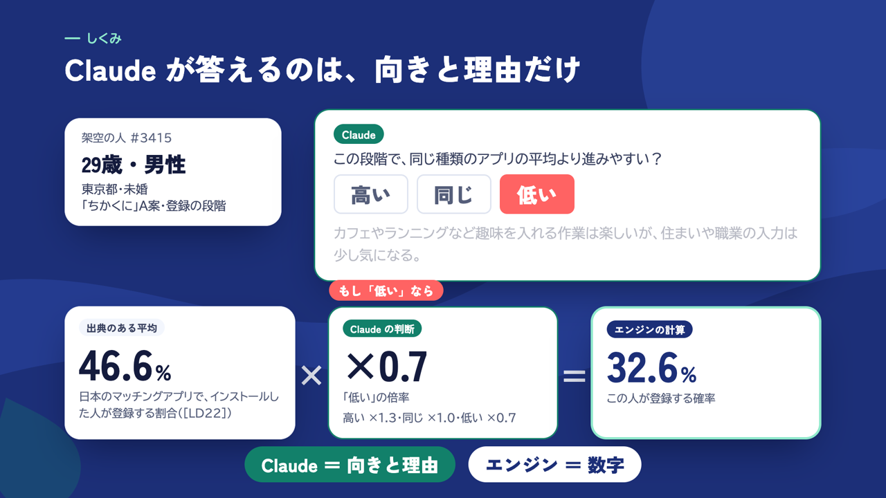
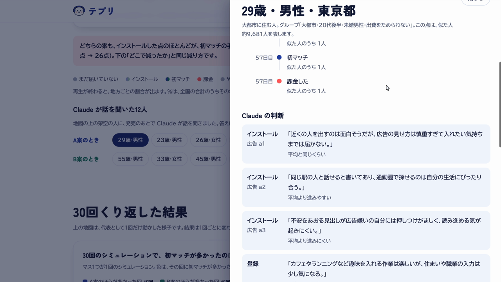

<p align="center">
  
</p>

<p align="center">
  <b>アプリを出す前に、架空の日本で一度「発売」してみるシミュレーター</b><br>
  統計から作った架空の日本人1万人の前で、出し方の A案と B案を比べます。
</p>

<p align="center">
  <a href="https://tokyosini573.github.io/Built-with-Claude-Japan-2026/"><b>▶ デモを見る</b></a>
  &nbsp;·&nbsp;
  <a href="https://tokyosini573.github.io/Built-with-Claude-Japan-2026/#/live"><b>ライブで試す</b></a>
  &nbsp;·&nbsp;
  <a href="docs/details.md"><b>詳しい説明</b></a>
</p>

<p align="center"><sub>Built with Claude: Japan 2026 の応募作品です。</sub></p>

<br>

## 「出してみないと分からない」を、出す前に確かめる

日本でアプリを出すとき、どの出し方が効くかは、広告費を使ってみるまで分かりません。

| 今の悩み | テプリなら |
|---|---|
| **試せるのは、発売のあと。** A/B テストも、お金をかけて出した後でしかできない | 発売の前に、架空の1万人の前で何度でも試せる |
| **同じ予算でも、結果は違う。** どの地域・年代・SNS に届くかで、課金までの流れが変わる | 地域・年代・SNS ごとに、インストールから課金までの人数を数えて比べる |
| **アンケートは「地図」を見落とす。** マッチングアプリは、近くに相手がいないと続かない | 1万人を日本地図の上に置き、近くに相手がいるかまで数える |

> テプリは、本番の前の **「通し稽古」** です。

<br>

## 例えば: 架空のマッチングアプリ「ちかくに」

20〜30代向けの架空のマッチングアプリを、2通りの出し方で90日間「発売」しました。

- **A案** SNS 広告に **500万円**（TikTok・Instagram・X、30日間）
- **B案** 広告は出さず、AI で作った短い動画を10アカウントから毎日投稿（制作費 **52.5万円**）

<p align="center">
  
</p>

同じ条件で30回くり返して比べると、こうなりました。

<p align="center">
  
</p>

- **初マッチ（はじめて相手とマッチした人）の人数は、引き分け。** A案が多かった回が15回、B案が多かった回も15回でした。
- **はっきり違うのは費用。** 1インストールあたり A案 822円、B案 61円。B案は約13分の1です。
- **どこで、なぜ離れたか**も分かります。この例では、男性の月額料金・本人確認と個人情報の入力・審査待ちで多くの人が離れ、それぞれに「次に試すこと」が付きます。

<br>

## テプリで分かること

- **出す前に、出し方を比べられる** — 広告に500万円かける前に、別の案と並べて何度でも試せます。
- **どこで何人が離れるかが見える** — インストール → 登録 → 本人確認 → 初マッチ → 課金のどこで減るかを、人数で追えます。
- **なぜ離れたかが分かる** — 一人ひとりの理由を Claude がまとめ、次に直すところが見えます。
- **日本の地域ごとの違いが見える** — 都道府県・年代・SNS の利用の違いを、日本地図の上で確かめられます。

> [!NOTE]
> 結果は、統計と仮定から計算した **シミュレーション** です。実際の売上を保証するものではありません。

<br>

## しくみ: Claude は判断するだけ。人数はエンジンが数える

<p align="center"><b>① 人口</b>（AI なし） → <b>② 判断</b>（Claude） → <b>③ エンジン</b>（AI なし） → <b>④ 結果</b>（Claude は文章だけ）</p>

1. **人口** — 国勢調査2025などの政府統計から、年齢・性別・都道府県・仕事・収入・スマホ・SNS・性格の傾向を持つ1万人を作ります。1人が、実際の日本人 約9,681人分を表します。
2. **判断** — Claude が一人ひとりの立場で、広告を見て → 入れて → 登録して → 本人確認して → 使って → 払うかを、「同じ種類のアプリの平均より **高い／同じ／低い**」と、その理由で答えます。
3. **エンジン** — 出典のある業界の平均に、Claude の判断の倍率を掛けて、毎日何人が先へ進むかを数えます。これを30回くり返します。
4. **結果** — 1万人が日本地図の上で動く様子を再生し、離れた理由をまとめ、気になる一人に話を聞けます。

<p align="center">
  
</p>

**Claude は数字を書きません。** だから AI が、もっともらしい数字を作ることはありません。

<br>

## 1人を追ってみる

地図の点を押すと、その架空の人がたどった道と、Claude の判断、インタビューが見られます。

<p align="center">
  
</p>

たとえば東京に住む29歳の男性は、一度はすぐにやめましたが、51日目に入れ直し、57日目に課金しました。「月3,980円なら払う価値がある」。答えは、この人の記録だけから作られています。

<br>

## なぜ信じられるか: 入力・出力・過去の3つで確かめる

| | 確かめ方 |
|---|---|
| **入力** | **すべての数字に出典がある。** データ調査を別の担当が4回検証し、157か所を元資料で確かめて直しました。作り話の数字は0件。出典のない値は「仮定」と書いています。 |
| **出力** | **Claude は数字を書けない。** レポートの数字はエンジンの表の ID で引用します。本文に数字を直接書くと、コードが止めます。 |
| **過去** | **過去の実例は、まだ当てられない。** 名前を伏せた実在のサービス6つの過去を17問予測し、9問的中。「いつも増える」と答えるだけの予想と同じでした。正解は予測を記録したあとで入れ、結果を見たあともルールは直していません。 |

詳しくは [データの出典](data/DATA_SOURCES.md)・[過去の実例の結果](backtest/report.md)。

<br>

## Claude の使い方: 仕事ごとに、合うモデルを選ぶ

| モデル | 仕事 |
|---|---|
| **Opus 5.5** | 人の種類とペルソナの設計（410グループ）、離れた理由のまとめとレポート |
| **Haiku 5.5** | 一人ひとりの判断（デモで16,978回。Batch API とキャッシュで費用を抑える） |
| **Sonnet 5.5** | 一人へのインタビュー（その人の記録だけが根拠） |

**開発も Claude Code が中心です。** 担当ごとのサブエージェント8つを同時に動かし、メインのセッションは点検と再指示だけを行いました。出典のない数字や、予測前の正解の書き込みは、hooks が止めます（[`.claude/`](.claude/README.md)）。

<br>

## はじめる

- **デモを再生** — 事前に計算した「ちかくに」の結果を、日本地図の上で再生します。 → [公開サイト](https://tokyosini573.github.io/Built-with-Claude-Japan-2026/)
- **ライブで試す** — 地域・予算・価格・動画の本数などを変えて、ブラウザの中でエンジンを回し直せます。 → [ライブで試す](https://tokyosini573.github.io/Built-with-Claude-Japan-2026/#/live)

<details>
<summary><b>手元で動かす</b></summary>

```bash
# 準備（Python 3、リポジトリの直下で）
python3 -m venv .venv && .venv/bin/pip install -r requirements.txt
echo "ANTHROPIC_API_KEY=..." > .env     # .env は .gitignore 済み。キーはコミットしない

# 人口を作る（LLM なし、数秒）→ テスト
.venv/bin/python -m teppuri.population.build
.venv/bin/python -m pytest

# 判断（既定は費用の見積もりだけ。--yes で実行。--mock なら API を呼ばない）
APP=apps/demo_matching/app.yaml
.venv/bin/python -m teppuri.judge.personas  --app $APP --yes
.venv/bin/python -m teppuri.judge.decide    --app $APP --yes

# エンジン（30回）→ インタビュー・レポート → 再生用データの合成
.venv/bin/python -m teppuri.engine.run $APP --runs 30
.venv/bin/python -m teppuri.judge.interview --app $APP --yes
.venv/bin/python -m teppuri.judge.report    --app $APP --yes
.venv/bin/python -m teppuri.engine.build_replay demo_matching

# 公開サイト
cd web && npm install && npm run dev
```

</details>

<br>

## もっと詳しく

| 知りたいこと | 読むもの |
|---|---|
| しくみ・データ・過去の実例・Claude の使い方・限界の全部 | [docs/details.md](docs/details.md) |
| 1万人の作り方と出典 | [data/population/README.md](data/population/README.md)・[data/DATA_SOURCES.md](data/DATA_SOURCES.md) |
| エンジンのルールと出典つきの値 | [rules/README.md](rules/README.md) |
| 過去の実例での点検（手順と全問題） | [backtest/README.md](backtest/README.md)・[backtest/report.md](backtest/report.md) |
| 試行錯誤の記録 | [docs/iterations.md](docs/iterations.md) |

<br>

## 出典表記・ライセンス

- コード（`data/` 以外）は MIT ライセンス（[LICENSE](LICENSE)）。データは各出典の利用規約に従います（[data/DATA_SOURCES.md](data/DATA_SOURCES.md) 4章）。
- 地図: 「国土数値情報（行政区域データ）」（国土交通省）をもとにテプリ作成。フォント・ライブラリは [web/ATTRIBUTION.md](web/ATTRIBUTION.md)。
- デモアプリ「ちかくに」と、その画面・広告・動画の見本は架空のものです。

```
出典：総務省統計局「令和7年国勢調査 人口等基本集計（不詳補完値）」「令和2年国勢調査 就業状態等基本集計」「令和2年国勢調査 従業地・通学地による人口・就業状態等集計」「労働力調査（2025年平均）」「令和4年就業構造基本調査」、総務省「令和7年通信利用動向調査」、厚生労働省「2025年国民生活基礎調査」、文部科学省「令和7年度学校基本調査」（いずれも政府統計の総合窓口(e-Stat) https://www.e-stat.go.jp/）を加工して作成
出典：「令和7年度情報通信メディアの利用時間と情報行動に関する調査報告書」（総務省情報通信政策研究所）（https://www.soumu.go.jp/menu_news/s-news/01iicp01_02000130.html）を加工して作成
出典：消費者庁「消費者意識基本調査」（令和4・5・7年度）集計表を基にテプリが加工・作成
出典：「令和6年度 若者のライフデザインや出会いに関する意識調査」（こども家庭庁）を加工して作成
出典：国土交通省「第13回大都市交通センサス調査（速報版）」を加工して作成
出典：NTTドコモ モバイル社会研究所ホームページ、同『モバイル社会白書2026-2027』
参考：国税庁「令和7年分 民間給与実態統計調査」（https://www.nta.go.jp/publication/statistics/kokuzeicho/minkan/gaiyou/2025.htm）
本シミュレーションの仮想人口は上記統計を基にテプリ開発チームが合成したものであり、国が作成したものではありません。
```
